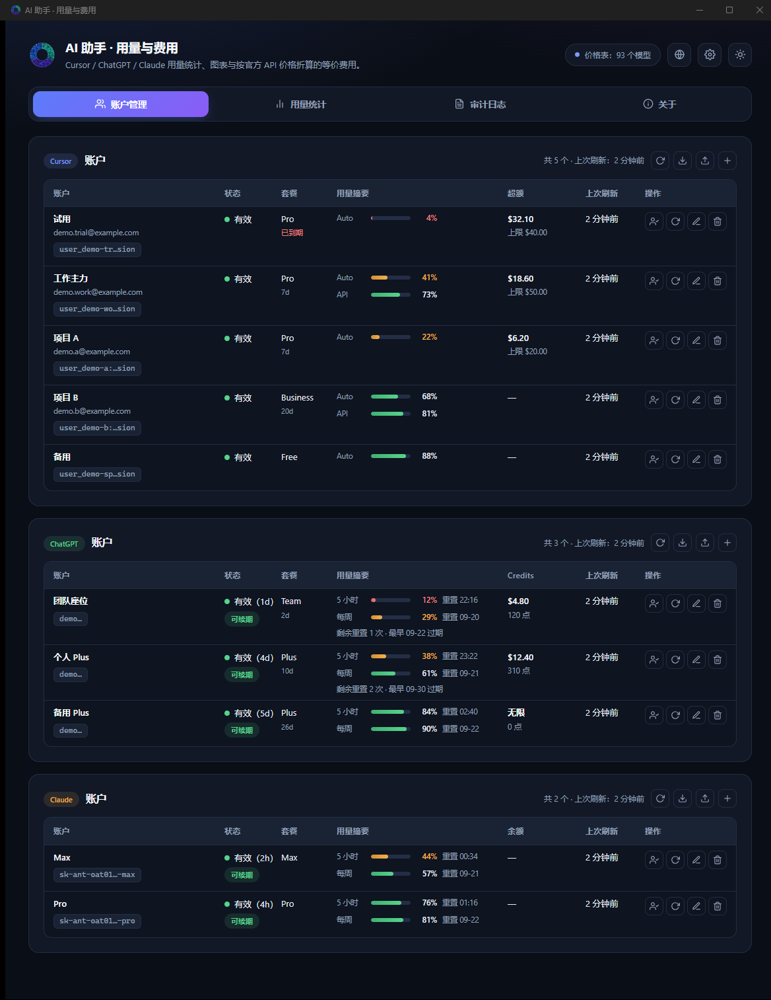
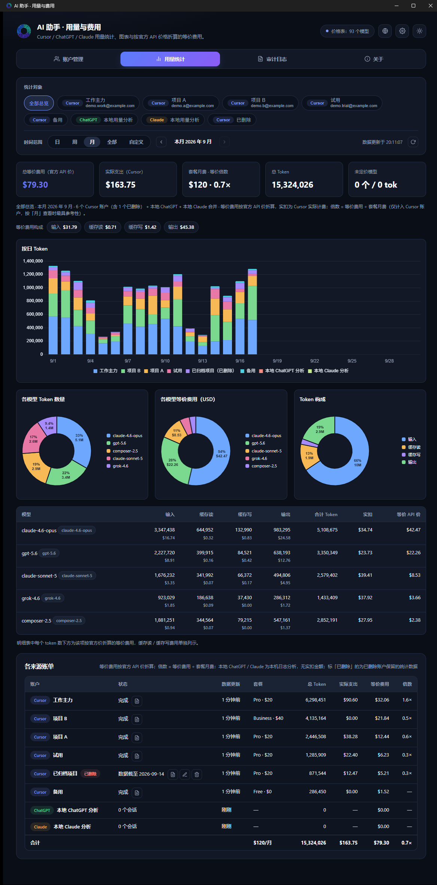
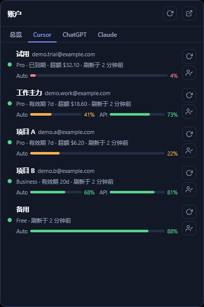

**English** | [简体中文](README.zh-CN.md)

<p align="center">
  
</p>

# my-ai-assistant

**my-ai-assistant** is a local desktop app for managing Cursor, ChatGPT, Claude, and OpenCode
accounts, checking plans and quotas, and summarizing token usage and costs by model.

Built with [Tauri](https://tauri.app/) 2, the app uses plain HTML / CSS / JavaScript,
[Chart.js](https://www.chartjs.org/) for charts, and [Marked](https://marked.js.org/) to parse
release notes for safe DOM rendering. Network requests are handled by Rust's `reqwest`. It currently
targets **Windows** and **macOS**. Unsigned installers for Windows x64 and macOS Apple Silicon are
available on [GitHub Releases](https://github.com/bgluminous/my-ai-assistant/releases).

Account requests go to official Cursor / OpenAI / Anthropic / OpenCode endpoints. App updates and
the default pricing table are fetched from GitHub; proxy connectivity checks use `inf.xil.to`.
Custom pricing sources and optional usage synchronization use addresses configured by the user.
Update requests never include account credentials.

> Usage and account status depend on non-public Cursor, OpenAI, Anthropic, and OpenCode APIs. Fields
> and availability may change at any time. Review each service's terms before use.

## Contents

- [Features](#features)
- [Screenshots](#screenshots)
- [Requirements](#requirements)
- [Build and Release](#build-and-release)
- [Configuration](#configuration)
- [App Updates](#app-updates)
- [Pricing Table](#pricing-table)
- [Data Sources](#data-sources)
- [Repository Layout](#repository-layout)
- [License and Disclaimer](#license-and-disclaimer)

## Screenshots

Account management, usage overview, and the tray account panel (shown with sample data):

<p align="center">
  
</p>
<p align="center">
  
</p>
<p align="center">
  
</p>

## Features

### Account Management

- Add and edit dialogs guard against accidental dismissal: clicking the backdrop first shows "Click
  again to close"; clicking it again within 2 seconds closes the dialog. Esc shows the same hint
  without closing or counting toward backdrop confirmation. Clicking inside or typing clears the
  confirmation. Close and Cancel dismiss immediately. Closing is disabled while saving, and failed
  saves preserve the entered values. Hints follow the light or dark theme.
- Manage Cursor, ChatGPT, Claude, and OpenCode accounts separately: add, edit, delete, and refresh.
  Import or export JSON by account type, or import the current type from a locally signed-in client.
- When deleting a Cursor account, "Keep statistics" is enabled by default. The app performs a final
  sync and retains its usage event archive locally, along with display information such as notes,
  email, and plan, but no tokens. The overview continues to include it, marked "Deleted". If the
  final sync fails, existing local data is retained; if none exists, deletion requires another
  confirmation. Adding the same account again (with the same `user_id`) reuses this archive without
  double counting.
- Add Claude accounts through OAuth in the app: sign in to claude.ai in your browser and paste the
  authorization code shown on the callback page. There is no need to locate tokens manually.
- The account list shows status, plan and validity, quota summaries, on-demand spending (Cursor) or
  Credits (ChatGPT), quota windows (5-hour and weekly windows for ChatGPT / Claude), remaining
  ChatGPT quota resets and their earliest expiration date when provided, and the last refresh time.
  The tray's secondary line shows only the reset count. Hovering over the count shows all returned
  reset records, including status, expiration, and acquisition / usage times when available. Used
  and expired records remain accessible when the remaining count is zero, including in the tray.
  Quota resets always show a specific time: time of day within 24 hours, a date otherwise, or
  "Reset" once passed. Within each group, paid plans are ordered by expiration (expired first),
  followed by plans with unknown expiration, then Free. The tray list and "Refresh all" follow the
  same order.
- Refresh automatically every 5 / 15 / 30 minutes or 1 / 6 / 12 / 24 hours, or manually refresh one
  account or a group. Each account's edit dialog offers "Follow global", a custom interval, or
  "Off"; new and existing accounts default to following the global setting. Per-account settings
  override the global interval and can stay enabled when global refresh is off. These settings are
  preserved in account exports and full backups. Scheduled refreshes process only due accounts, one
  at a time in the current card and account order; failures wait a full interval before retrying.
  The initial refresh runs 3 seconds after startup for enabled accounts. Changing an interval
  restarts its timer from the save time. A completed manual refresh or a refresh from another window
  postpones that account's next scheduled refresh. Inline refresh indicators stay synchronized
  across windows. Shared ChatGPT / Claude logs and GPT cross-device sync continue to use the global
  interval; local credential checks retain their own setting.
- Reorder the four account group cards by dragging the handle to the left of each title, or focus
  the handle and use the up / down arrow keys. The order is saved locally and included in full
  backups. Accounts within each card remain sorted by plan.
- Switch the local Cursor / ChatGPT (or Codex) client to a chosen account and launch it. Claude
  switching writes Claude Code credentials locally: `~/.claude/.credentials.json` on Windows, or
  Keychain on macOS. Claude Desktop is only coordinated as a client: it is closed if running and
  launched afterward if installed. Client paths can be set manually or found in common locations.
  Successful switch dialogs close after 3 seconds, with a button countdown and manual dismissal;
  failure dialogs remain open until dismissed.
- Sign out of local Cursor / ChatGPT / Claude Code clients using "Sign out locally" in each group
  header. Running clients are closed before local login data is cleared. Cursor login keys are
  removed from its authentication database; ChatGPT account credentials are removed from
  `auth.json`, preserving `OPENAI_API_KEY` if configured; Claude Code's account login section is
  removed while other entries remain. Files are backed up before changes. Managed accounts are
  unaffected, and clients are not restarted automatically.
- ChatGPT / Claude accounts can retain a `refresh_token` and renew before the access token expires.
  ChatGPT follows the Codex CLI policy: refresh the entire credential set when less than 5 minutes
  remain, or when expiry cannot be parsed and more than 8 days have passed since acquisition. A 401
  / 403 response triggers one additional attempt. Each renewal rotates the `refresh_token`, which
  has no readable expiration date. Claude renews near expiry or after a 401 / 403 response.
- ChatGPT accounts store a complete copy of the local Codex client's `auth.json`, including
  `id_token`. Renewal, switching, and local import all write the complete copy. Adding or editing
  credentials manually immediately exchanges the `refresh_token` for a full set. Synchronization is
  bidirectional: credentials renewed by the app are written back to local `auth.json`. A background
  check watches its modification time at the configured interval (5 minutes by default; configurable
  from 1 minute to 1 day). When ChatGPT Desktop / Codex CLI renews credentials, saved copies for the
  same account are updated without network access, independently of scheduled refresh. Local
  credentials are checked again before refresh or switching; if renewal is rejected, the app retries
  once using local credentials for the same account. Switching writes the saved copy directly when
  it is complete and outside the renewal window; otherwise, it renews first. If the `refresh_token`
  is invalid, the result dialog offers "Force write and launch" to write the saved copy directly.

### OpenCode Official Plans

- Click "+" in the OpenCode group to choose "Import from this device" or "New OAuth authorization".
  Both options accept a note. Local import lists workspaces and imports only the selected one after
  confirmation; independent authorization can be completed later in the edit dialog. Existing
  accounts support note changes and reauthorization. Each official workspace has one account and one
  statistics source.
- Supports Go ($10/month), Go Plus ($40/month), Go Teams ($20/member/month), and Console
  pay-as-you-go accounts. Teams monthly fees use only the member count returned by the API; unknown
  counts are not estimated. Quotas cover the authorized member's 5-hour, weekly, and monthly
  windows. The balance is shared across the workspace. Individual read failures are flagged and
  retain cached values.
- Client import and switching support OpenCode V2 only. Settings allow custom CLI executable and
  database paths. Switching uses the official credential activation API; if no matching login
  exists, it opens the client's native authorization flow. This app and the OpenCode client hold
  separate OAuth sessions, so renewing this app's session does not overwrite client credentials.
- Usage aggregates official model calls across the entire workspace, including all members, devices,
  and service accounts, without per-member breakdowns. Workspace totals require Owner or Admin
  authorization; ordinary members' personal records are excluded. The initial sync backfills the
  last 30 days; subsequent incremental syncs overlap the previous 48 hours. "Refresh" can fetch the
  last 30 days again while retaining older local history. Missing periods are flagged as incomplete
  coverage. Hours, days, weeks, and months use local time.
- Usage statistics show equivalent costs calculated from official API prices; the costs recorded by
  OpenCode remain in the archive. Positive costs in Go logs are not treated as wallet deductions.
  Manual resync also checks official per-model token totals for the most recent complete UTC day;
  discrepancies do not overwrite request-level records.
- Account exports include encrypted independent authorization. Full backups also include historical
  archives and coverage periods. Restore associates local logins by workspace without copying client
  OAuth credentials. The CLI and database paths are restored from the backup. Deleting an OpenCode
  account also deletes its local archive. Data beyond the server's retention period can only be
  recovered from backups.

See [OpenCode integration and validation](docs/opencode-integration.md) for plan sources and API
semantics.

### Usage Statistics

- Data comes from saved accounts and is fetched when the page opens. Results have a short-lived
  cache shared with the tray overview and can be refreshed manually at any time.
- Select multiple sources by clicking their chips. "All sources" selects everything; deselecting all
  sources returns to the overview. A single selection opens its dedicated view: individual Cursor
  accounts support snapshots, and local log analysis supports custom directories and rescanning. Two
  or more selections combine their statistics in the overview layout, with only the selected sources
  in the "Bills by source" table.
- Time ranges combine a period with navigation: day (today by default), week (starting Monday),
  month, or all time. Arrows move one period backward or forward, never beyond today. "Custom"
  accepts start and end dates and can shift by the selected range's length. Reopening the main
  window from the tray resets the range to "Day / Today". Ranges of up to two days use hourly bars
  from 0 to 24, highlighting the current hour when today is included. Longer ranges use daily bars.
  Week / month axes cover complete calendar periods, always oldest to newest. "Today" shares the
  tray overview's daily cache.
- Refreshing Cursor / OpenCode status prefetches usage for the corresponding account in the
  background. Per-account scheduled refreshes do not speed up shared ChatGPT / Claude log tasks.
  Manual refreshes still update local logs, and "Refresh" on the statistics page also refreshes the
  relevant account status.
- The tray overview reuses the usage page's shared cache. Navigate by day up to today; reopening the
  panel returns to today. Totals and the source pie chart use the selected day's data, while the bar
  chart shows its 24-hour token distribution. All charts include legends. The header shows the
  data's last update time and marks expired data as "Cached". Statistics and account refreshes show
  the same floating progress hint as the main statistics page. Opening the panel, switching to the
  overview, or changing the date forces a sync if data has not synced for more than 5 minutes,
  regardless of the scheduled refresh interval.
- With scheduled refresh enabled, Cursor / OpenCode usage follows each account's effective interval;
  shared logs follow the global interval.
- **Overview**: shows total tokens, equivalent costs at official API prices, monthly plan fees, and
  cost multiples for each source. Charts include daily / hourly token bars stacked by source, four
  doughnut charts for tokens by model, equivalent costs by model, token composition, and tokens by
  account / source, plus a per-model detail table. Doughnut charts use a two-by-two grid, changing
  to one column in narrow windows. The source chart aggregates tokens over the selected range,
  showing the top eight sources and grouping the rest as "Other". Cursor / OpenCode accounts and
  deleted accounts are counted separately; ChatGPT / Claude logs each form a shared source and are
  not allocated to individual accounts. OpenCode labels in filters, tables, and legends use the
  account note, falling back to email and then workspace name.
- **Cursor account data**: each account maintains a complete local usage event archive containing
  raw model names, four token categories, actual charges, timestamps, and billing categories. Any
  time range is sliced from this archive and valued using the current pricing table; switching
  ranges requires no network request. Only refreshing triggers sync. Incremental sync starts at
  midnight on the date of the latest stored event and replaces data from that point onward.
  "Refresh" on the statistics page forces a full fetch.
- **Exclude API quota usage**: each Cursor account has a separate switch in "Edit account", off by
  default. Enabling and saving it removes records charged against the plan's API-priced allowance
  and pay-as-you-go overages, and excludes them from future syncs. Classification uses billing
  categories and model quota ownership, not a literal model name of `API` or a nonzero charge. Auto,
  Composer 1.5 / 2 / 2.5, and Cursor Grok records within their own quotas are retained, as are
  custom API key records without a Cursor Token Fee, free records, and failures explicitly marked as
  uncharged. Cursor does not currently return each record's quota pool, so temporary charges to the
  API allowance for first-party models cannot be identified precisely. Older bills first fetch
  missing billing information online. If records cannot be matched or billing categories are
  unknown, saving fails and existing data remains unchanged. Statistics, bills, CSV exports, and
  snapshots all exclude removed events. Disabling the switch does not restore local data, though a
  later sync may fetch it again. The setting is saved with the account, included in import / export,
  and shared by the main window and tray.
- **Individual Cursor accounts**: aggregate input / output / cache read / cache write tokens by
  model within the selected range, with equivalent costs at official API prices. Snapshots use the
  same calculation.
- **Monthly plan fees and cost multiples**: Cursor / OpenCode use the selected accounts; ChatGPT and
  Claude each total the known monthly fees of all added accounts, counting each account once. The
  multiple is the selected sources' total equivalent API cost divided by their known monthly fees.
  Unrecognized plans are excluded only from the denominator; their usage stays in the numerator. If
  fees are zero or all unknown, the multiple is `—`. The multiple card appears for day, week,
  month, all-time, and custom ranges. Fees always use the full listed monthly price, with no daily
  proration. The "Monthly plan fee" column consistently shows USD per month (for example,
  `$200/month`), or `—` when unknown. Remaining days, annual discounts, and taxes are not factored
  in. ChatGPT distinguishes Pro $100 / $200 / $500; Claude distinguishes Pro, Max 5x / 20x, Ultra,
  and identifiable Team seats. Plans are detected automatically; unknown tier prices are not
  guessed. Device filters change usage only and do not count monthly fees again.
- **Raw bills**: the single-account toolbar and inline buttons in "Bills by source" open individual
  usage events for that account and time range. Records include Cursor's raw model name, four token
  categories, official charges, and the normalized name / matched pricing key / equivalent cost
  under the current pricing table. Data is read from the local archive without network access.
  Filter by model name or export CSV with a UTF-8 BOM. Retained data from deleted accounts is also
  available.
- **Clear local data**: this action in the raw bill dialog and Cursor's "Edit account" dialog
  deletes the account's local event archive and statistics cache while retaining the account and
  token. The next usage refresh fetches the full archive again.
- **Deleted accounts**: retained statistics appear as separate "Deleted" rows in the overview,
  totals, and combined charts, only when they contain usage within the selected range. "Edit
  account" changes the display name; leaving it blank restores an automatic label with email /
  account ID fallbacks. "Change plan" selects a fixed tier, useful when the session had expired at
  deletion and the plan was not recorded. Active accounts get their plans from the API and cannot be
  edited manually. "Delete statistics" permanently removes retained data. When retained data exists,
  a "Deleted" chip appears at the end of the source selector and acts as one group in
  multi-selection. Selecting it alone shows combined usage and per-account bills for all deleted
  accounts. The tray overview also includes this data. In "Edit account", disabling "Keep API quota
  history" permanently removes related details and statistics and locks the switch off; notes remain
  editable. Importing older backups respects the disabled state and applies the same cleanup. Older
  bills without billing details use approximate model ownership: third-party models are removed and
  models with their own quotas are retained. This may remove custom API key records or miss paid
  overages for first-party models; the dialog explains this limitation. Records with billing details
  still use their billing category. Unknown categories or unrecognized models cause saving to fail,
  leaving existing data unchanged.
- **Local ChatGPT sessions**: scans Codex CLI logs (default: `~/.codex/sessions`) to aggregate
  tokens and equivalent costs by model. Parsing is incremental by file modification time. Cumulative
  usage counters deduplicate records within the same session lineage: repeated usage reports after
  quota refreshes / session resumes, and parent history copied into fork / sub-agent logs, count
  only once, using the original parent record's timestamp.
- **GPT usage sync**: configure an HTTPS central server and an account sync key in Settings to share
  usage details across machines running MAA. The server address is empty by default; without it,
  only local data is collected. Use "Test connection" to verify the account, then "Done" at the
  bottom of Settings to save and sync. "Use proxy" is enabled by default and follows global proxy
  settings. Disabling it connects directly to the sync server, ignoring system, environment, and
  custom proxies. Connection tests use the current form selection; saving applies it to all sync
  operations. Sync follows "Accounts and refresh → Scheduled refresh", even without managed
  accounts. Upgrades preserve the existing global interval and do not enable a disabled schedule.
  Sync continues while MAA runs in the tray and stops on exit. Refresh buttons on the tray account
  page, tray overview, and statistics page all sync GPT usage, regardless of selected sources.
  Opening or switching to the tray overview, or changing its date, fetches updates when at least 5
  minutes have passed since the last successful sync. Manual refresh and stale tray refresh remain
  available when scheduled refresh is disabled. Concurrent triggers from multiple windows share one
  background sync. Charts first show existing data, update when local collection finishes, then add
  other devices' usage after server sync. Network failures preserve local statistics, and manual
  refresh can retry immediately. The statistics page, sync settings, and tray share live progress
  across scanning, organizing, connecting, uploading, and downloading. Upload progress counts
  acknowledged records; downloads show stored record and page counts without estimating an overall
  percentage. Counts remain visible after success or failure. Tray success hints disappear after 5
  seconds; failure hints remain available. The first collection reads all history; later uploads and
  downloads are incremental. Removing original Codex logs does not remove collected history. When
  both ends support filtering local records, history is restored before upload, and routine
  downloads do not return local records again. If only 10 local records are new, the result is
  "Uploaded 10 · Downloaded 0"; recovery after clearing the cache may include local history. Older
  servers keep the compatible sync flow. Upgrading the server enables filtering automatically. Only
  models, timestamps, token counts, and session identifiers are uploaded, never conversation text,
  file paths, or GPT login credentials. The server can read these details; each machine calculates
  costs using its own current pricing table. The overview and tray show all devices; the GPT-only
  view supports device filtering. Devices identify collection sources, so copied logs may appear
  under multiple devices, but totals across all devices are deduplicated. Older logs without session
  identifiers cannot be deduplicated across machines. Synced cache can be cleared by device in the
  current MAA instance, preserving unuploaded records, server data, and other machines. Later scans
  or syncs can restore it. Collection directories and device names stay local and are not migrated
  with backups. Connection settings, including "Use proxy", are backed up; device identity, cache,
  and cursors are not. Older backups without sync settings leave current settings intact;
  configurations missing "Use proxy" default to enabling it. Legacy standalone sync intervals in
  settings and backups are ignored and do not override the global interval. Administrators create
  accounts under "MAA Sync → Account Management" on the server. All machines for the same account
  use the same key while keeping separate device identities. Sync keys are unrelated to OpenAI API
  keys or GPT login credentials. "Test connection" verifies only the account; a device is registered
  on its first successful sync, even when there are no logs. Disabling an account pauses automatic
  sync. After an administrator reenables it, click "Refresh" on the statistics page to resume.
  Resetting a key requires updating every machine; server history is retained. To host your own
  server, click "Copy prompt" below the sync settings and give the complete setup document to your
  agent. It ships with the app and can be copied offline, covering the v1 API, storage requirements,
  and acceptance checks without including local settings or keys.
- **Local Claude Code sessions**: scans Claude Code logs (default: `~/.claude/projects`, with
  multiple directories supported through `CLAUDE_CONFIG_DIR`) to aggregate tokens and equivalent
  costs by model. Deduplication uses message ID + request ID + session, preventing duplicate
  streaming records and sidechain replays from being counted twice.

### Other Features

- **Audit log**: records account changes, import / export, status changes, refresh failures, ChatGPT
  / Claude renewal and local login sync, local account switching, usage snapshots, raw bill exports,
  deletion and reuse of retained account statistics, local usage cleanup, interval changes, startup
  settings, online pricing updates, and full backup import / export. Each entry has a level (Info /
  Warning / Error) and category (Accounts / Status and Refresh / Credentials and Sync / Usage Data /
  Settings and System). Filter by level or category, or clear the log. Every detected change to the
  local ChatGPT login file records the sync result: how many accounts were updated, or why none
  were. Logs use JSON Lines and rotate at the size limit, retaining approximately the latest 2,000
  entries.
- **System tray**: closing the main window minimizes the app to the tray and keeps scheduled refresh
  running. Single-click opens the account panel; double-click opens the main window. The panel hides
  when it loses focus or is clicked again via the tray icon. The tray menu offers Show Main Window
  and Quit; only Quit ends the process. Reopening a hidden or minimized main window restores its
  initial position for the current launch.
- **Launch at login**: enable startup in Settings (Windows Registry Run entry / macOS LaunchAgent).
  Optional "Silent startup" launches directly into the tray without showing the main window.
- **Data backup**: export all settings, accounts including tokens, interface preferences, and
  retained statistics for deleted Cursor accounts to one JSON file, with optional password
  encryption using PBKDF2-SHA256 + AES-256-GCM. Import merges accounts by identity. Deleted-account
  statistics are also merged by identity: entries are skipped if the same account is active locally,
  and the newer copy wins when retained data already exists. Other settings follow the backup and
  take effect immediately without restart. Active accounts' event archives are not included; refresh
  after import to sync them again.
- **Display**: dark / light themes and token formatting as full numbers, K / M / B, or Chinese
  ten-thousand / hundred-million units.
- **Network proxy**: system proxy, direct connection, or a custom HTTP / SOCKS proxy, effective
  immediately after saving.
- **Single instance**: launching again brings the existing main window forward, avoiding concurrent
  configuration reads and writes.

## Requirements

- [Node.js](https://nodejs.org/) 20.19 or later for frontend dependencies and development tools.
- The [Rust](https://rustup.rs/) toolchain (`rustup`).
- Platform linker:
  - **Windows**: Visual Studio Build Tools with "Desktop development with C++" (MSVC and Windows
    SDK).
  - **macOS**: `xcode-select --install`.
- **Windows** requires the [WebView2](https://developer.microsoft.com/microsoft-edge/webview2/)
  runtime, which is usually preinstalled on Windows 11.

## Build and Release

```bash
npm install
npm run tauri dev      # Run in development mode
npm run tauri build    # Build an installer for the current platform
```

On Windows, `npm run release:windows` collects installers and the portable build into `release/` and
creates 7z archives. It removes `src-tauri/target` after a successful build by default. For options
to keep the build cache, reuse artifacts, or generate update signatures, see the
[packaging script](scripts/build-release-windows.ps1) help:
`Get-Help ./scripts/build-release-windows.ps1 -Full`.

Pushing a `Release-X.Y.Z` branch publishes Windows x64 and macOS Apple Silicon releases. Manually
running Actions only builds. Credential setup and retry instructions are documented beside the
relevant steps in the [release workflow](.github/workflows/release.yml). Version and platform
parameters are in [.version-settings](.version-settings).

GPT sync data structures and content hashes are documented in
[codex_store.rs](src-tauri/src/codex_store.rs); transport and recovery logic are in
[codex_sync.rs](src-tauri/src/codex_sync.rs). See the
[GPT sync tests](scripts/codex-sync-tests/README.md) for standalone validation.

## Configuration

User data directories:

| Platform      | Path                                   |
| ------------- | -------------------------------------- |
| Windows       | `%USERPROFILE%\.xilore\myaiassistant\` |
| macOS / Other | `~/.xilore/myaiassistant/`             |

Older versions used `xilore/myaiassistant/` without the leading dot. At startup, if the old
directory exists and the new one does not, the entire directory is moved automatically. If both
exist, the new directory is used and the old one is left untouched.

| File                              | Contents                                                                                                                                        |
| --------------------------------- | ----------------------------------------------------------------------------------------------------------------------------------------------- |
| `settings.json`                   | Accounts, refresh intervals, proxy, pricing overrides, Cursor / ChatGPT / Claude Desktop / OpenCode client paths, and silent startup preference |
| `opencode-usage.sqlite`           | Official OpenCode request archive, sync watermarks, and historical coverage periods; SQLite WAL sidecar files may appear at runtime             |
| `audit.jsonl`                     | Audit log                                                                                                                                       |
| `codex-usage.sqlite3`             | GPT usage archive, device identity, per-space caches, sync acknowledgments, and cursors; SQLite WAL sidecar files may appear at runtime         |
| `usage-archive/<account-id>.json` | Cursor usage events and sync times; deleted accounts also retain notes / email / plan and deletion time, without tokens                         |

These paths can be copied from the app.

`settings.json` is written to a temporary file and then replaced atomically. Read failures at
startup, such as a briefly locked file, are retried without overwriting it with empty data. JSON
parse failures first create a backup as `settings.json.bad`.

**Credentials are stored locally.** Cursor / Claude tokens are plain text. Independent OpenCode
authorization and ChatGPT's `auth.json` are stored only as encrypted copies using AES-256-GCM. The
key is embedded in the app, so encryption prevents direct reading but does not protect against
reverse engineering. Tokens are decrypted at runtime; older plain-text credentials are migrated
automatically on first launch. Do not commit this directory to version control or share
`settings.json`. Audit logs contain only notes or masked tokens, never complete credentials.

Theme, token display units, and account card order are stored in the WebView's `localStorage`,
outside `settings.json`; full backups include these interface preferences. The launch-at-login
switch is registered with the operating system (Windows Registry / macOS LaunchAgent) and does not
migrate with backups.

## App Updates

The app checks for updates 30 seconds after launch and every 24 hours afterward. Disable automatic
checks in Settings, or check manually from About at any time. Release notes for the current and
available versions support Markdown. In-app notes show categories such as "Added" and "Fixed"
directly, without repeating an overall title; installer lists, download guidance, and installation
instructions are on GitHub Releases.

Each release's notes live in [docs/releases](docs/releases). An agent prepares them after reviewing
the release's commits and code changes, and they are committed with the release. The release process
validates and reads this text rather than assembling it from commit messages. "Release history"
loads registered versions for the current platform on demand, with version selection, list refresh,
and retries. Loaded notes are cached for the current app session. Older unregistered versions remain
available on GitHub Releases.

Browsing history does not change the pending update. Web links open in the system browser, and raw
HTML is not executed. Current release notes remain visible when the app is already up to date.
Confirming an update downloads, installs, and restarts the app; downloads can be canceled. Progress
follows actual bytes smoothly. When the total size is unknown, an indeterminate animation is shown
instead of an estimated percentage. Progress animations respect the system's reduced-motion setting.
Failed checks retain the reason and offer retry, proxy settings, and GitHub Releases. Background
failures do not open dialogs or browsers, and silent startup keeps the window hidden.

Windows NSIS / MSI installations update using the same installer type; portable builds require
manual downloads from Releases. On macOS Apple Silicon, automatic updates work after moving the app
into a writable installation directory. Running from a DMG or a non-writable directory prompts
manual installation. Older clients must manually install a version containing the updater once
before using in-app updates.

Before installation, new app operations are paused until pending writes finish; operations resume on
failure, timeout, or cancellation. Mandatory updates restrict older versions' operations but still
require installation confirmation; backups can be exported first. Update preferences migrate with
settings backups.

## Pricing Table

- The bundled default table, `src-tauri/resources/pricing.default.json`, contains 126 entries. The
  2026-10-23 price review corrected DeepSeek Flash and added 23 entries, including Sonnet / Haiku
  5.5, GPT-5.1, GPT-4.1 Nano, Chat Latest, Gemini 4 Argon, Gemini Flash-Lite, Grok 4.7, GLM,
  MiniMax, and Mistral / Codestral.
- Prices are in USD per million tokens, using official standard-tier API prices for short contexts.
  Fields are `input`, `output`, `cacheRead`, and `cacheWrite`. `cacheWrite=0` means no separate
  per-token write charge is included; it does not mean that cache storage, TTL, or other additional
  fees are all free.
- Official pricing references:
  [Anthropic](https://platform.claude.com/docs/en/about-claude/pricing),
  [OpenAI](https://developers.openai.com/api/docs/pricing),
  [Google](https://ai.google.dev/gemini-api/docs/pricing),
  [xAI](https://docs.x.ai/developers/pricing),
  [DeepSeek](https://api-docs.deepseek.com/quick_start/pricing/),
  [Z.ai](https://docs.z.ai/guides/overview/pricing),
  [MiniMax](https://platform.minimax.io/docs/pricing/overview), and
  [Mistral](https://docs.mistral.ai/inference/pricing).
- Haiku 5.5 uses prices for inputs of up to 100K; above that, input, output, cache read, and cache
  write prices are all five times higher. Anthropic cache writes use the default 5-minute tier.
  MiniMax M3 uses prices for inputs of up to 512K. These long-context tiers are not yet included in
  cost calculations.
- Gemini 4 Argon's listed prices apply through 2026-11-30 and double on 2026-12-01. Gemini 3.8
  Flash's listed prices apply through 2026-12-31 and double on 2027-01-01. Prices do not switch
  automatically by date; the table must be updated when promotions end.
- DeepSeek uses off-peak pricing. `deepseek-v4-flash`, `deepseek-v4.1-flash`, and other numbered
  versions all use the effective `deepseek-flash` prices: $0.15 input, $0.60 output, $0.003 cache
  read, and $0 cache write. Usage statistics retain specific version names, while the pricing table
  maintains only `deepseek-flash`. Online updates or user changes to this entry apply to every
  version. Version-specific prices in older tables are ignored without rewriting historical settings
  on load. Adding or saving a version-specific entry prompts the user to edit the base entry
  instead.
- Standard and Fast prices for GPT-6 Sol, GPT-6 Luna, and GPT-6.1 Sol were checked on 2026-10-15.
  GPT-6.1 Sol cache reads cost $0.10 per million tokens; GPT-6 Sol cache reads cost $0.20. All four
  Fast prices are twice the standard prices. Long-context surcharges remain excluded.
- GPT-6.1 Terra and GPT-6 Rosalind were added on 2026-11-02. Terra's input, output, cache read, and
  30-minute cache write prices per million tokens are $1, $5, $0.05, and $1.25; all four double for
  Fast. Rosalind's standard prices are $15, $75, $1.50, and $18.75. Both use short-context pricing.
- Override order is bundled defaults → online cache → user overrides. Only user prices that differ
  from the underlying defaults / cache are saved in `settings.json` under `pricing`. Online changes
  are applied manually after checking; failures preserve the cache and user overrides.
- The default online source is
  [pricing.json](https://raw.githubusercontent.com/bgluminous/open-source-registry/main/resources/my-ai-assistant/pricing.json)
  in the public repository. Empty URLs, old official default URLs, and older backups migrate
  automatically; custom sources remain unchanged. The table retains `note`, `models`, and the
  existing price fields and can be updated independently of app releases. Updates publish the same
  bundled table to the online file, preventing stale remote data from overwriting corrected prices.
  Clients with an older cache must check and apply the new table through "Online update". Failed
  checks offer retry, proxy adjustment, or the public repository file.
- Models missing from the table are marked "Unpriced". Equivalent costs use each model provider's
  official API prices; distributor bills such as Cursor's are used only to verify reported model
  names. Composer, available only through Cursor, uses Cursor's official prices as its provider
  prices.
- Fast entries cover verified OpenAI Fast mode, Anthropic Opus 5.5 / 5 / 4.8 fast mode, and Cursor
  Composer 2.5 Fast, using the base model key plus `-fast`. Without a matching Fast entry, Fast
  usage appears as a separate row valued at standard prices, showing the applied base key. xAI API
  Priority costs twice the standard rate, while Grok 4.7 Fast is available only in Cursor / Grok
  Build. They are distinct offerings; a reported `-fast` name alone does not establish API Priority
  usage. Max is an effort level, not a pricing tier, and uses the base model price.
- Pending verification: Qwen requires a confirmed region and caching method before applying any
  general cache discount; see
  [model pricing](https://www.alibabacloud.com/help/en/model-studio/model-pricing) and
  [cache rules](https://www.alibabacloud.com/help/en/model-studio/context-cache). Exact prices for
  Kimi K2.6 and K2.7 Code Highspeed remain unverified; see the
  [model list](https://platform.kimi.ai/docs/models). Kimi K3 cache writes are charged separately by
  TTL; `cacheWrite=0` currently means this is not covered. See
  [billing details](https://platform.kimi.ai/docs/pricing/chat). OpenAI Ultrafast will be supported
  once its service tier can be identified reliably.
- Default prices are estimates for reference. RMB pricing, multimodal fees, unlisted long-context
  tiers, and historical time-based prices require separate handling. Check providers' current
  pricing before use.
- The default table is compiled into the binary, so changing bundled entries requires rebuilding.
  Installed versions can fetch the remote table through "Online update" or edit prices manually on
  the pricing page.

## Data Sources

| Source         | Authentication                                                                          | Purpose                                                                                                                                  |
| -------------- | --------------------------------------------------------------------------------------- | ---------------------------------------------------------------------------------------------------------------------------------------- |
| Cursor         | `WorkosCursorSessionToken` (supports `user_xxx::<jwt>`; `%3A%3A` is normalized to `::`) | Usage summaries, billing cycles, event aggregation, weekly Grok quota, account email, and local account switching                        |
| ChatGPT        | `Authorization: Bearer` + `ChatGPT-Account-Id`                                          | Quota windows and subscription details; renewal uses OAuth `refresh_token`                                                               |
| Claude         | `Authorization: Bearer` (OAuth access token) + `anthropic-beta: oauth-2025-04-20`       | Quota windows (5-hour / weekly), account email and organization; authorization and renewal use the same OAuth (PKCE) flow as Claude Code |
| Local sessions | No network access                                                                       | Reads Codex CLI `sessions/**/*.jsonl` and Claude Code `projects/**/*.jsonl`, aggregating per-turn tokens by model                        |

Cursor plan validity comes from the current billing cycle's start and end dates; the provider renews
it and resets quotas at expiration. ChatGPT plan validity comes from the subscription API, as JWTs
usually lack this field. Claude's API does not provide subscription start / end dates; only quota
windows and reset times are shown.

## Repository Layout

```text
my-ai-assistant/
├── LICENSE                   # GNU GPLv3
├── package.json              # npm scripts, frontend dependencies, and test tools
├── app-icon.png              # Source app icon
├── docs/screenshots/         # Sample screenshots for the README
├── scripts/                  # JS syntax checks and local Windows packaging
├── src/                      # Frontend (Tauri frontendDist)
│   ├── index.html            # Main window
│   ├── tray.html             # Tray panel
│   └── vendor/               # Bundled Chart.js, Marked, and license notices
└── src-tauri/                # Rust backend
    ├── Cargo.toml
    ├── tauri.conf.json
    ├── capabilities/
    ├── resources/pricing.default.json
    └── src/                  # Accounts, usage, audit, tray, proxy, pricing, and local clients
        └── tests/            # Per-module unit tests, matching source filenames and included via #[path]
```

## License and Disclaimer

This application is licensed under the [GNU GPLv3](https://www.gnu.org/licenses/gpl-3.0.html). You
may copy, modify, and redistribute it, including commercially. Redistribution must retain copyright
notices, provide the corresponding source code, and use the GPLv3 license. When referencing or
deriving from this project, credit BGLuminous and the
[original project](https://github.com/bgluminous/my-ai-assistant). See [LICENSE](LICENSE) for the
complete terms.

This application uses non-public Cursor, OpenAI, and Anthropic APIs solely to query your own
accounts and usage locally. Users are responsible for consequences arising from API changes, account
restrictions, or conflicts with service terms. This repository is not affiliated with Cursor,
OpenAI, Anthropic, Google, or xAI.
