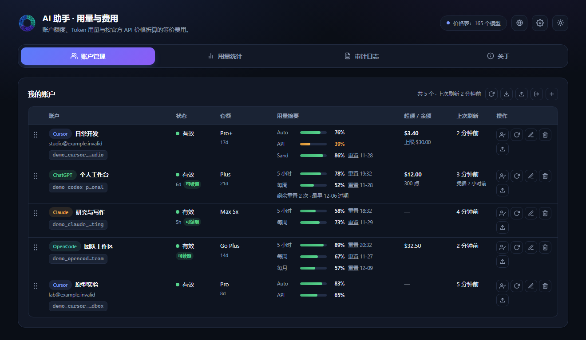
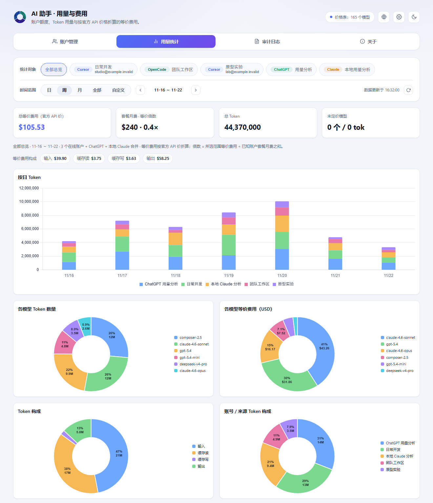
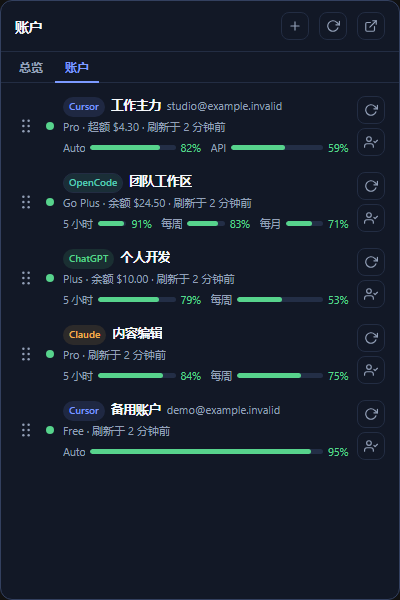

**English** | [简体中文](README.zh-CN.md)

  

# my-ai-assistant

Manage Cursor, ChatGPT, Claude, and OpenCode accounts in one desktop app. See which account has
quota left, when it resets, and how many tokens each model used. Usage data stays on your device
by default, with optional GPT usage sync across your own machines.

Available for Windows x64 (installer or portable build) and macOS Apple Silicon.
[Download the app](https://github.com/bgluminous/my-ai-assistant/releases) ·
[User guide](docs/guide.md)

## Account Management

Compare plans, remaining quotas, and refresh times across accounts. Refresh a row or switch the
login used by a local client. For GPT / Codex, Claude, and OpenCode you can switch the CLI,
the desktop client, or both. The screenshots use sample data.

  

## Usage Statistics

Explore Cursor billing events, OpenCode workspace requests, and local Codex and Claude Code
sessions together. Break down token usage by date, model, or source and compare its equivalent API
cost with monthly plan fees. Export billing details or save a usage snapshot for a single Cursor
account.

  

## System Tray

Check quotas, switch accounts, and see today's usage from the tray. Scheduled refreshes continue
while the main window is hidden.

View the tray account panel

  

[Build from source](docs/guide.md#build-and-release) ·
[Release notes](docs/releases) · [GNU GPLv3 license](LICENSE)
