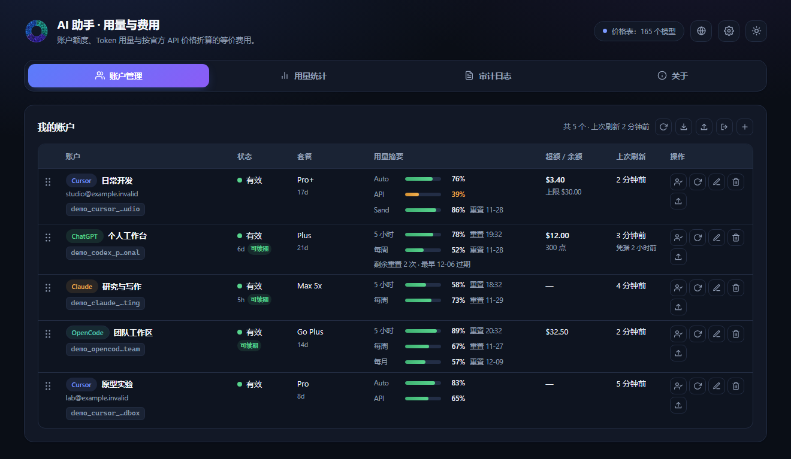
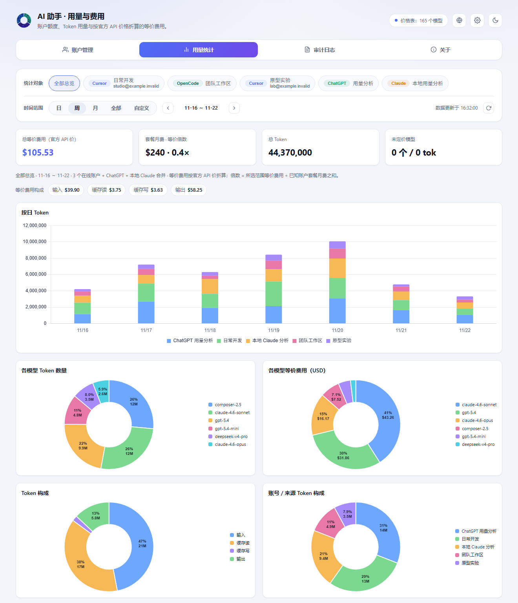
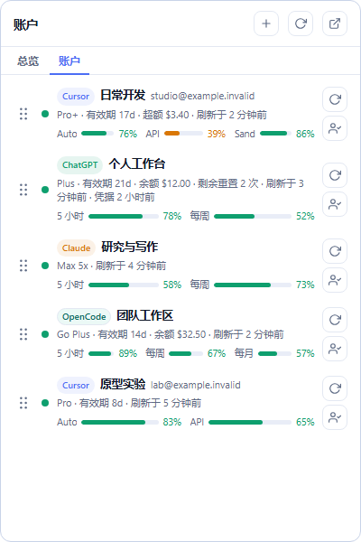

[English](README.md) | **简体中文**

  

# my-ai-assistant

my-ai-assistant 是一款管理 Cursor、ChatGPT、Claude 和 OpenCode 账户的桌面应用。
在一个窗口就能看到哪个账户还有可用额度、何时重置，以及各模型用了多少 Token。
用量数据默认保存在本机，也可以在自己的设备间同步 GPT 用量。

提供 Windows x64 安装版、便携版及 macOS Apple Silicon 版。
[下载应用](https://github.com/bgluminous/my-ai-assistant/releases) ·
[使用指南](docs/guide.zh-CN.md)

## 账户管理

账户列表并排显示各服务的套餐、剩余额度和上次刷新时间。可以直接刷新或切换本机登录，
也可以为 GPT / Codex、Claude 和 OpenCode 分别选择 CLI、桌面客户端或两者。
以下界面使用示例数据。

  

## 用量统计

在同一页汇总 Cursor 账单、OpenCode 工作区请求，以及本机 Codex 和 Claude Code 的会话用量。
可以按日期、模型或来源比较 Token 用量，查看按 API 单价折算的费用与套餐月费的比值，
并导出账单明细或单个 Cursor 账户的用量快照。

  

## 托盘面板

在托盘中也能查看额度、切换账户和浏览当天用量。主窗口收起后，定时刷新仍会继续。

查看托盘账户面板

  

[从源码构建](docs/guide.zh-CN.md#构建与发布) ·
[版本日志](docs/releases) · [GNU GPLv3 许可证](LICENSE)
